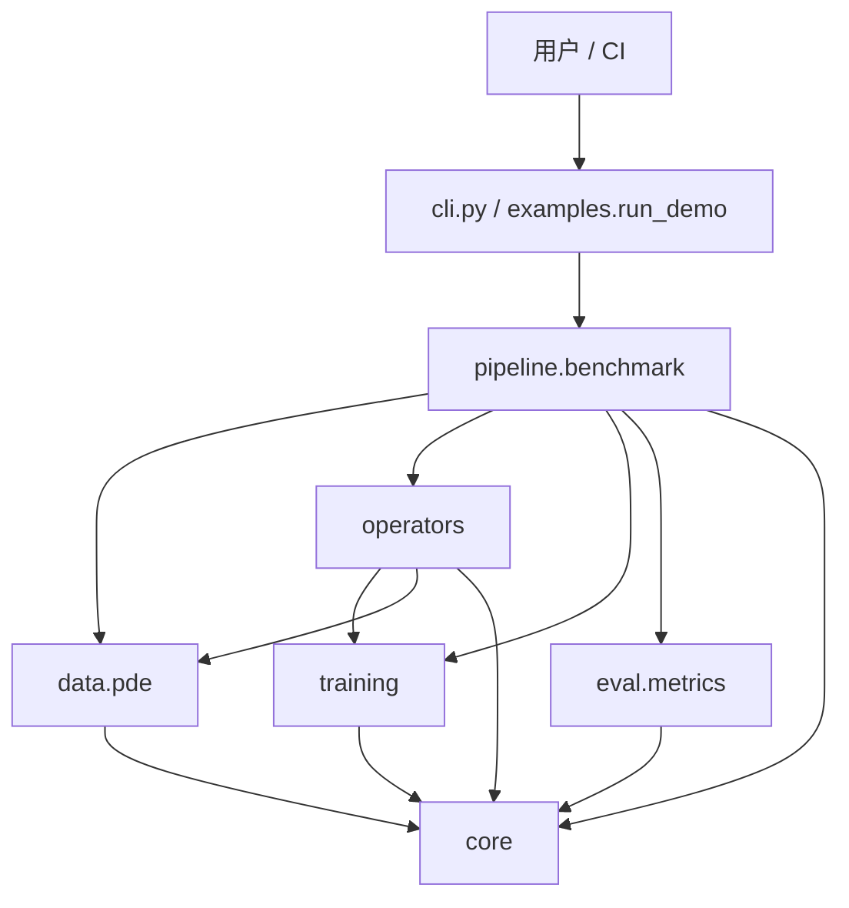
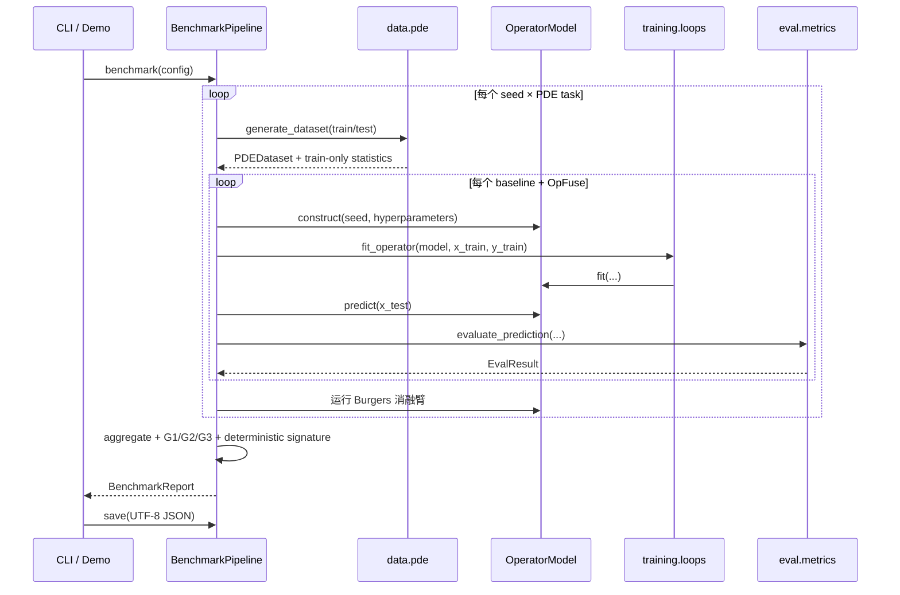

# OperatorForge 架构说明

> 作者：晨星  
> 版本：0.1.0  
> 目标：以可复现、可证伪的数值证据比较神经算子与经典数值基线。

## 1. 分层架构与依赖方向



依赖只从入口与编排层指向领域层和基础层；`core` 不依赖上层。唯一有意的跨领域依赖是经典粗网格基线 `operators.coarse` 调用 `data.pde` 中的 PDE 求解器。不存在运行时网络、GPU 或外部服务依赖。

## 2. 模块职责

| 层 | 模块 | 责任与边界 |
|---|---|---|
| 公共门面 | `operatorforge/__init__.py` | 导出配置、报告、注册器与基准流水线；固定版本和作者信息。 |
| 入口 | `cli.py`, `examples/run_demo.py` | 参数解析、UTF-8 输出、执行基准、落盘与双跑确定性检查。 |
| 编排 | `pipeline/benchmark.py` | 生成数据、训练、评估、聚合、门禁判定、消融、失败案例和稳定签名。 |
| 数据 | `data/pde.py` | 生成独立训练/测试折；求解 Burgers、对流扩散与 Darcy 方程。 |
| 算子 | `operators/*` | FNO、OpFuse、DeepONet、MLP、CNN、RBF 与粗网格数值基线；统一 `fit/predict` 契约。 |
| 训练 | `training/autograd.py`, `optim.py`, `loops.py` | 实数反向 AD tape、Adam、闭式 ridge 训练编排。 |
| 评估 | `eval/metrics.py` | 相对 L2、相对 H1、高频尾误差与 Parseval 残差。 |
| 基础 | `core/*` | 不可变配置、随机种子、稳定错误码、Protocol 与跨层 dataclass。 |

## 3. 核心数据结构与接口

### 3.1 `OperatorModel` 协议

```python
class OperatorModel(Protocol):
    name: str

    def fit(self, x: FloatArray, y: FloatArray) -> Self: ...
    def predict(self, x: FloatArray) -> FloatArray: ...
```

训练输入的形状为 `(batch, L)` 或 `(batch, H, W)`，预测保持批维与空间形状。FNO、CNN、MLP 与 OpFuse 支持分辨率改变；DeepONet 与 RBF 是固定离散化基线。

### 3.2 数据与报告

- `OperatorTask`：任务名、输入/输出空间形状、坐标与 PDE 元数据。
- `PDEDataset`：互不重叠的 train/test 数组及**只由训练折拟合**的均值和尺度。
- `TrainResult`：模型、任务、seed、训练损失、耗时和优化器元数据。
- `EvalResult`：相对 L2/H1、高频尾误差、超分辨率误差和推理耗时。
- `BenchmarkReport`：配置、逐运行结果、聚合、门禁、消融、失败案例和总耗时。

## 4. 关键算法约定

### 4.1 复数线性的实数参数化

频谱张量最后一维固定为 `(real, imag)`。若输入为 `Xr + iXi`，权重为 `Wr + iWi`，则：

```text
Yr = Xr @ Wr - Xi @ Wi
Yi = Xr @ Wi + Xi @ Wr
```

所有可训练参数与梯度均为 `float64`；测试分别对输入、`Wr`、`Wi` 做中心差分检验，而不是只检查组合模型。

### 4.2 FFT 与 Parseval

NumPy 默认正向 FFT 不归一、逆变换除以 `L`。对 `rfft` 的单边谱，内部频率能量必须乘 2，DC 与偶数长度的 Nyquist 项除外：

```text
Σ |x_j|² = (|X_0|² + 2 Σ_internal |X_k|² + |X_Nyquist|²) / L
```

### 4.3 误差方向

相对 L2、相对 H1、高频尾误差均为**越小越好**。单样本相对 L2 定义为 `||prediction-target||₂ / max(||target||₂, 1e-12)`，报告取样本均值。

### 4.4 Seed 派生规则

- `set_all(seed)` 同时设置 Python `random`、NumPy legacy RNG、`PYTHONHASHSEED`，并返回 `np.random.default_rng(seed)`。
- 数据生成按基准 seed 派生：`train_seed = 2*seed + 101`，`test_seed = 2*seed + 102`。
- 模型内部随机矩阵使用独立 `default_rng(model_seed)`；同 seed、同数据、同超参必须逐位复现参数和预测。
- 跨进程确定性签名排除 `elapsed_sec`，其余核心结果排序后做 SHA-256。

## 5. 程序调用时序



## 6. 冻结门禁与独立实测

以下数值来自仓库 `benchmark.json` 的三 seed 快速基准（17、29、43）。门禁阈值来自 `core.config.GATE_THRESHOLDS`，不得为迎合结果而改动。

| Gate | 冻结判据 | 实测值 | 结论 |
|---|---|---:|---|
| G1 性能 | OpFuse / 最强基线 ≤ 0.90，且优势 > `0.5 × (σ_opfuse + σ_baseline)` | OpFuse 0.171104；FNO 0.222008；ratio 0.770711；effect 0.050904；required 0.012856 | 通过 |
| G2 分辨率迁移 | OpFuse ≤ `1.05 × FNO`，且优于最强非频谱模型 10% | OpFuse 0.223114；FNO 0.223114；上限 0.234269；非频谱最佳 0.769078 | 通过 |
| G3 梯度 | 分层中心差分最大相对误差 ≤ 1e-6 | 5.606e-10 | 通过 |
| G3 对流扩散 | 数值解与解析 Fourier 半群最大误差 ≤ 1e-8 | 0.0 | 通过 |
| G3 Parseval | 最大绝对能量残差 ≤ 1e-12 | 7.105e-15 | 通过 |
| G4 确定性 | 两次独立运行的核心签名逐位相同 | SHA-256 `a7d344d6343ae7b64de58f0adab4b574d1e50df92a68bd88f791e9b71ffa705e` | 通过 |

这些结果是给定有限 DGP、超参和 CPU/NumPy 实现下的证据，不代表对任意 PDE、网格或分布的普遍优势。

## 7. 错误与降级契约

| 类别 | 稳定码 | 典型来源 |
|---|---|---|
| 数据 | E100 | 非法 PDE 参数、未知任务、非有限输入 |
| 模型 | E200 | 未拟合预测、形状错误、未知/不可用算子 |
| 训练 | E300 | Adam 超参、梯度名称/形状/有限性错误 |
| 评估 | E400 | 指标形状、空批次、非有限值错误 |
| 配置 | E500 | ENV 转换、网格、模态、seed 或学习率错误 |

错误注册器同时拒绝重码与重名。可选后端不可用时，注册器不公开该模型；基准报告必须记录 `status="skipped"` 和原因，相关指标保持 `null`/缺失，禁止用零或占位数字伪造成功结果。
